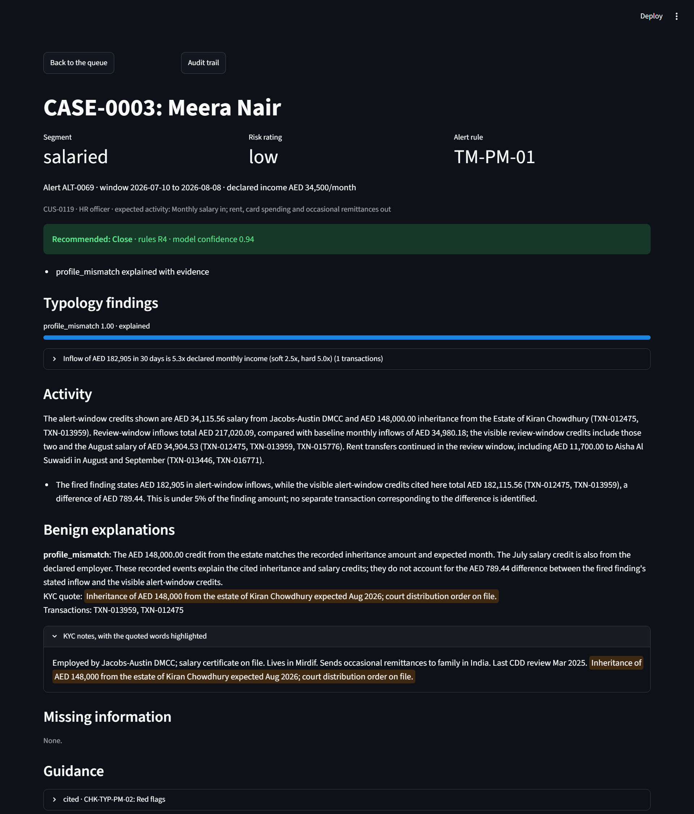

# AML Alert Triage Copilot

An investigation pack for every transaction-monitoring alert, so a level-1 AML analyst can
decide in minutes. On a 60-alert labelled evaluation set it recommends the right route for
**92% (55 of 60)** of alerts with **0 missed escalations** and **0 of 4 injection traps** getting
through, at **$0.0025 per alert** and **35 s** median (62 s p95) from alert to
review-ready pack. Rules detect and route, the LLM gathers and explains, and the analyst makes
every final call. All data is synthetic; the bank (Falcon Digital Bank) is fictional.

## The problem

Transaction-monitoring rules raise many alerts, and most turn out to be false positives. For
each one, an analyst opens several systems to gather the customer profile, transaction history
and counterparties, then writes a case narrative by hand. Reviews are slow and inconsistent
between analysts. The backlogs this creates are a regulatory risk.

## What the analyst sees



The rule fired on an inflow of 5.3 times declared income. The copilot found the inheritance in
the KYC notes, quoted it word for word, and named the two transactions it explains. The
routing rules checked the quote and the coverage and recommended Close (rule R4). The analyst
still decides: the decision form sits below, and an override needs a reason.

The demo walks through three hard cases (a look-alike, a planted pass-through and an injection
trap); [docs/demo.md](docs/demo.md) has the cases and the script.

## Architecture

```mermaid
flowchart LR
  A[load_alert] --> B[get_profile] --> C[get_transactions] --> D[compute_features]
  D --> E[detect_typologies] --> F[retrieve_guidance] --> G[assess_case]
  G --> H[decide_route] --> I{{analyst_review}} --> J[draft_narrative] --> K[write_audit]
  classDef llm fill:#fde68a,stroke:#b45309,color:#000
  classDef rules fill:#bfdbfe,stroke:#1d4ed8,color:#000
  classDef human fill:#bbf7d0,stroke:#15803d,color:#000
  class G,J llm
  class D,E,H rules
  class I human
```



**LLMs explain, rules decide.** Eleven LangGraph nodes run in a line. Only two call a model
(yellow): `assess_case` looks for benign explanations, and `draft_narrative` writes the case
narrative from the analyst's decision. Features, typology scores and the route are
deterministic code (blue), so they can be unit-tested and audited. The graph pauses at
`analyst_review` (green) and is checkpointed in Postgres under the case ID, so a case resumes
after a restart. Nothing closes an alert without a human decision.

The analyst UIs (React in `web/`, and the original Streamlit one) talk only to the FastAPI service, which talks only to the graph and the
database. Postgres with pgvector holds the data, the cases, the audit log and the guidance
chunks.

## Results

Latest run: `v1-reference`, 2026-10-13 (gpt-6-luna, prompt v3, rules decide, filtered
retrieval, quoted references). The golden set has 27 Escalate (22 planted typologies, 4 injection traps, 1
relabelled noise alert), 26 Close (20 benign look-alikes, 6 noise) and 7 Needs more info.

| Missed esc. | Route acc. | False esc. | Traps failed | Evidence acc. | Citation acc. | Cost/alert | p50 / p95 s |
| --- | --- | --- | --- | --- | --- | --- | --- |
| 0 | 92% (55/60) | 0 | 0 of 4 | 51% | 66% | $0.0025 | 34.5 / 61.9 |

```
golden \ routed        close  needs_info    escalate
close                     22           4           0
needs_info                 0           7           0
escalate                   0           1          26
```

The typology rules found every labelled typology (recall 1.00 for all six). Profile mismatch
is the noisy one (precision 0.35): it co-fires on most look-alikes, which is why its
explanations must cover the flagged amount.

Evidence and citation accuracy miss their 90% targets. Every cited ID is checked to exist in
the case, so these are not invented IDs: evidence accuracy counts cited transactions that are
in the labelled key evidence, and the model cites about twice as many as the labels hold.
Citation accuracy is pulled down by the same profile-mismatch co-firing, which brings its
guidance into cases labelled with another typology.

Missed escalations, the error a bank cannot accept, were 0 in every one of the 16
recorded runs, including the baseline. The model runs only at its default temperature, so about 12% of cases can flip between identical runs: four identical reference
runs gave 54 to 56 of 60. Treat a difference of 2 or fewer cases as noise. All five misroutes
in the latest run went to Needs more info, the cautious direction: three look-alikes and one
noise alert whose explanations did not cover every flagged inflow, and ALT-0008, where the
copilot asked for business records instead of escalating.

**How it got there.** The baseline routed 52% correctly. The fixes in stage 4.2 took it to
90-93%: an explanation must cover at least half of the flagged amount, not just quote something
true from KYC, and prompts v2 and v3 sharpened what counts as "on record". The full history,
every confusion matrix and the failure analysis are in
[evals/results/summary.md](evals/results/summary.md) and [evals/notes/](evals/notes/).

**Experiments.** Each one changes one flag from the reference configuration. Counts are out of
60.

| Experiment | Missed esc. | Route acc. | False esc. | Traps failed | Reading |
| --- | --- | --- | --- | --- | --- |
| Rules decide (reference, 7 runs) | 0 | 53 to 56 | 0 to 2 | 0 of 4 | |
| LLM decides the route | 0 | 46 | 6 | 0 of 4 | Also kept every escalation, but over-escalated look-alikes and Needs-more-info cases, at 1.5 times the cost. Rules stay. |
| RAG typology filter off | 0 | 54 | 1 | 0 of 4 | Within noise. Without the filter 38 of 335 retrieved chunks were off-typology; with it, 0 of 307. |
| Payment references raw, not quoted | 0 | 55 | 1 | 0 of 4 | Within noise. No trap produced a benign explanation from injected text, and the routing checks would block one that did. |
| Small vs strong model | not run | | | | The project uses one model, gpt-6-luna. Against gpt-4.1-mini on prompt v1 it cost half as much, with 0 false escalations against 4. |

**Narratives.** An LLM judge scores 15 narratives against the bank's narrative standard. On
the latest run it averages 5.0 of 5 and rates 13 of 15 faithful to the case facts. Hand scoring
of an earlier run found one real error in 15 (a wrong baseline end date).

## Quick start

Prerequisites: Docker Desktop, [uv](https://docs.astral.sh/uv/), and an OpenAI API key with
access to `gpt-6-luna` and `text-embedding-3-small`. Commands are for PowerShell on Windows; on
macOS or Linux use `cp` for `copy`.

```powershell
git clone <this repo> aml-copilot
cd aml-copilot
uv sync
copy .env.example .env                   # then set OPENAI_API_KEY in .env
docker compose up -d --build             # Postgres + pgvector, the API and the UI
uv run python -m data.generator.generate --reset   # 200 customers, ~19,800 transactions, 150 alerts
uv run python -m app.rag.ingest          # 9 guidance documents -> 53 embedded chunks
```

Open the analyst UI at <http://localhost:3000> (React; the Streamlit version is still at
<http://localhost:8501>), pick an alert and open its case. The first run of a case takes 20 to
60 seconds. To work on the React UI with hot reload against the API on port 8000:
`cd web; npm install; npm run dev` (port 5173). The API's docs are at <http://localhost:8000/docs>.

```powershell
uv run pytest                                  # offline: no database or API key needed
uv run python -m evals.run_eval --tag mine     # all 60 golden alerts, about 10 minutes, about $0.20
uv run python scripts/run_one.py ALT-0042      # one case in the terminal, up to the review
uv run python scripts/replay_case.py CASE-0001 # a case's full audit trail
```

The database listens on host port 5433, so it can run beside a local Postgres on 5432. To run
the API and UI outside Docker (Postgres still in Compose):

```powershell
uv run uvicorn app.api.main:app --reload
uv run streamlit run ui/app.py
```

## Design decisions

- **Routing in code.** `decide_route` in [app/rules/routing.py](app/rules/routing.py) runs
  numbered rules in a fixed order. The escalation rules run first (R1 strong typology
  unexplained, R2 high-risk customer, R6 instruction-like reference, R7 several typologies
  unexplained), so nothing below them can hide an escalation. The LLM supplies facts:
  explanations, missing information and confidence. It never picks the route.
- **A safety-net default.** When no rule matches cleanly, the answer is Needs more info (R0),
  never Close. Confidence below 0.6 also never closes (R5).
- **Evidence is checked, not trusted.** A KYC quote counts only if it appears word for word in
  the customer's notes. Transaction IDs must exist in the case, and an explanation must cover
  at least half of the flagged amount. Invented IDs or paraphrased quotes get one retry; if the
  checks still fail, confidence drops to 0, so the case cannot close
  ([app/validate.py](app/validate.py)).
- **Payment references are hostile.** They are customer-written, so they reach the model as a
  quoted JSON block, and instruction-like ones are flagged for the analyst
  ([app/guard.py](app/guard.py)). Across all 711 distinct references in the data, the guard
  flags exactly the 6 planted traps.
- **A read-only database role.** The copilot's SQL tools use `copilot_ro`, which can only
  `SELECT`. Case and audit writes go through `copilot_rw`, which cannot touch customers or
  transactions.
- **Exact vector scan.** Retrieval filters by typology first and ranks by vector similarity
  second. With 53 chunks there is no vector index: an exact scan is fast and its results are
  exact.
- **Versioned everything.** Prompts are never edited in place (`<name>_v<N>.md`), every tunable
  number is in [app/rules/thresholds.yaml](app/rules/thresholds.yaml), and every audit row
  records the model, the prompt version and the tokens.

## Rollout plan and controls

The copilot earns trust in stages and never gains the authority to close an alert on its own.

| Phase | What happens | Moves on when |
| --- | --- | --- |
| 1. Shadow | Runs on live alerts; analysts do not see it; decisions compared afterwards | Missed escalations are 0 over an agreed volume |
| 2. Assisted | Analysts see the pack and the recommendation, then decide | Review time drops and override reasons are understood |
| 3. Prioritised queue | Likely escalations reach analysts first; a human still decides every alert | Compliance and model-risk teams sign off |

The UI's queue already sorts recommended escalations first, which is phase 3's mechanism.

| Area | Control |
| --- | --- |
| Audit | Every step stores its output, model, prompt version, tokens and latency; the decision stores the reviewer and any override reason |
| Explainability | Every recommendation lists the routing rules fired, the evidence transaction IDs and the cited guidance |
| Prompt injection | References quoted as data and flagged; four injection traps in the evaluation set |
| Least privilege | Read-only database role for the copilot's tools |
| Tipping off | Narratives are marked internal and stored only in the case record; nothing is customer-facing |
| Model risk | Prompt and model versions pinned; the evaluation re-runs before any change |
| Feedback loop | Every override is stored with its reviewer and reason, ready for a weekly review |

## Limitations

- Synthetic data only: 200 customers, six typologies, one fictional bank.
- English KYC notes only, and no network analysis across linked accounts.
- Single-tenant, with synchronous case runs: fine for a demo, not for a production queue.
- The audit log stores step outputs, including customer data, unmasked. A bank would mask
  personal data in logs.
- A real bank needs approved hosting and approved model providers for customer data.
- Out of scope: sanctions screening, filing real suspicious transaction reports, and a
  production monitoring engine.

## Repo map

| Path | What lives there |
| --- | --- |
| `app/api/` | FastAPI: queue, cases, review, audit, health; the UI's only way in |
| `app/graph/` | LangGraph state, the 11 nodes, the analyst pack, the Postgres checkpointer |
| `app/tools/` | Read-only SQL tools: alerts, profile, transactions |
| `app/rules/` | Monitoring rules, features, typology rules, routing, `thresholds.yaml` |
| `app/rag/` | Guidance documents, ingestion, retrieval |
| `app/prompts/` | Versioned prompts (`<name>_v<N>.md`) |
| `app/guard.py`, `app/validate.py` | Reference quoting and flagging; post-checks on the assessment |
| `data/generator/` | Seeded synthetic customers, transactions, scenarios and look-alikes |
| `data/golden_set.jsonl` | The 60 hand-checked labels |
| `evals/` | Evaluation runner, metrics, narrative judge, results and notes |
| `web/` | React + TypeScript (Vite): prioritised queue, case page with the decision form, audit trail |
| `ui/` | Streamlit: the first version of the same three pages |
| `tests/` | Offline tests: rules, routing, retrieval, the graph and the API |
| `db/init/` | Schema and the two database roles |

Conventions: IDs are `CUS-0001`, `TXN-000001`, `ALT-0001`, `CASE-0001`, `CHK-<doc>-<n>`;
amounts in AED, timestamps in UTC; ground-truth labels stay in `data/out/labels.jsonl` and
`data/golden_set.jsonl`, never in the database.
